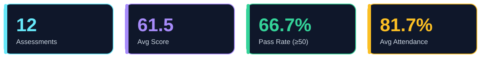
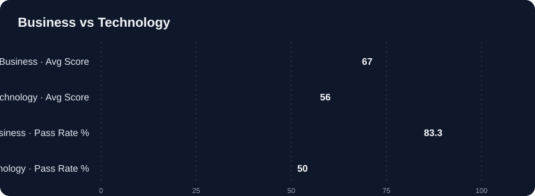
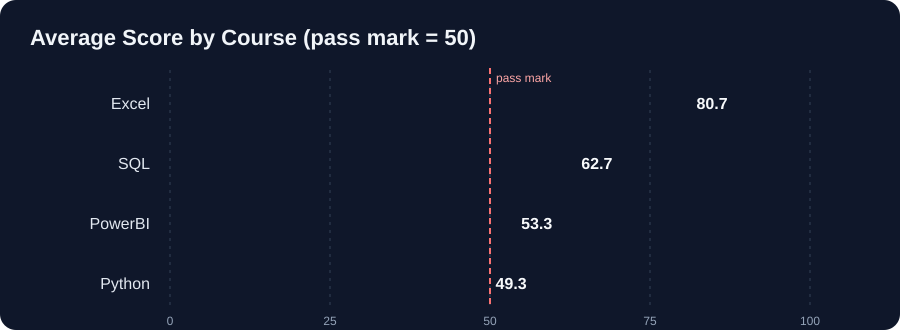
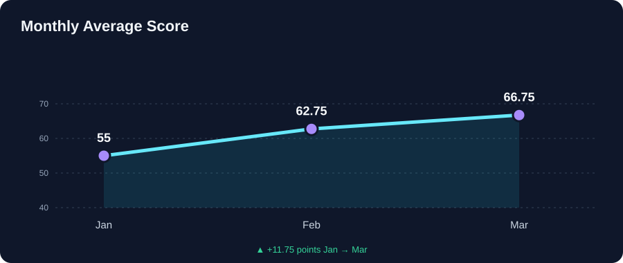
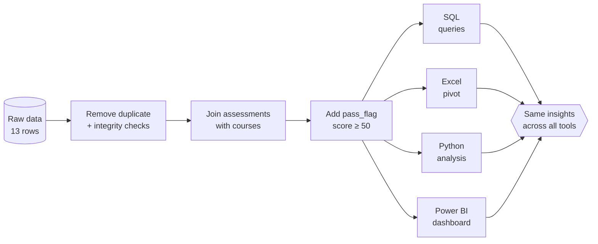

<p align="center">
  
</p>

<p align="center">
  
  
  
  
  
</p>

<p align="center">
  <b>One dataset, four tools.</b> The same training-assessment data is cleaned, analysed and visualised in SQL, Excel, Python and Power BI, and every tool reaches the same conclusions.
</p>

---
** Explanation Video link** 
https://drive.google.com/file/d/1pEEGEAXpb_bbzNgIb5LGzMK1QHCScrZp/view?usp=drive_link
## 📌 Table of Contents
- [Project Overview](#-project-overview)
- [Key Results](#-key-results)
- [Key Insights](#-key-insights)
- [Dataset](#-dataset)
- [Workflow](#-workflow)
- [Tool-by-Tool Breakdown](#-tool-by-tool-breakdown)
- [Repository Structure](#-repository-structure)
- [How to Run](#-how-to-run)
- [Recommendations](#-recommendations)
- [Skills Demonstrated](#-skills-demonstrated)
- [Author](#-author)

---

## 🎯 Project Overview

A training team runs courses across two departments and three batch timings. This project answers:

1. Which **department** and **course** perform best and worst?
2. Which courses are **underperforming** (average score below 60)?
3. Which **batches** score highest?
4. How do scores **trend** from January to March?
5. Is **attendance** related to performance?

**Pass mark:** a score of **50 or above** counts as a pass (`pass_flag = 1`).

---

## 🏆 Key Results

<p align="center">
  
</p>

### Business vs Technology

<p align="center">
  
</p>

### Course performance

<p align="center">
  
</p>

### Monthly trend

<p align="center">
  
</p>

---

## 💡 Key Insights

| # | Insight | Evidence |
|---|---------|----------|
| 1 | **Business outperforms Technology** | Avg score 67.0 vs 56.0; pass rate 83.3% vs 50.0% |
| 2 | **Excel is the strongest course** | Avg 80.7, 100% pass rate (3 of 3) |
| 3 | **Python is the weakest course** | Avg 49.3, only 33.3% pass rate (1 of 3), the only course below the pass mark |
| 4 | **Underperforming courses (avg < 60)** | Python (49.3) and PowerBI (53.3) |
| 5 | **Evening batch leads** | Evening 67.0, Morning 61.25, Weekend 56.25 |
| 6 | **Scores improve every month** | Jan 55.0 → Feb 62.75 → Mar 66.75 |
| 7 | **Attendance and score move together** | Correlation r ≈ 0.98 (12 observations) |

> ⚠️ **Caveat:** the dataset has only 12 assessments (3 per course). The patterns are clear but should be treated as indicative, not statistically conclusive. The attendance correlation shows association, not causation.

---

## 🗃️ Dataset

Two tables joined on `course_id`.

**`assessments`** (fact table, 12 rows after cleaning)

| Column | Description |
|--------|-------------|
| `assessment_id` | Unique assessment ID |
| `month` | Jan / Feb / Mar |
| `course_id` | Foreign key to `courses` |
| `batch` | Morning / Evening / Weekend |
| `score` | Assessment score (0–100) |
| `attendance_pct` | Attendance percentage |

**`courses`** (dimension table, 4 rows)

| course_id | course | department |
|-----------|--------|------------|
| C1 | Excel | Business |
| C2 | PowerBI | Business |
| C3 | SQL | Technology |
| C4 | Python | Technology |

**Derived field:** `pass_flag = 1 if score >= 50 else 0`

### 🧹 Data quality checks
- **Duplicate removed:** `assessment_id = 12` was loaded twice (13 raw rows → 12 clean rows).
- **Orphan check (both directions):** no courses without assessments, no assessments without a course.
- **Assertions in Python:** `len(merged_df) == 12` and zero unmatched departments after the left join.

---

## 🔄 Workflow



---

## 🛠️ Tool-by-Tool Breakdown

### 🗄️ SQL (MySQL): `sql/sql_setup.sql`
Creates the schema with a primary key and foreign key, loads the data, removes the duplicate row, and runs the analysis queries.

```sql
-- Underperforming courses (average score < 60)
SELECT c.course, AVG(a.score) AS avg_score
FROM assessments a
JOIN courses c ON a.course_id = c.course_id
GROUP BY c.course_id, c.course
HAVING AVG(a.score) < 60;

-- Top two batches by average score
SELECT batch, AVG(score) AS avg_score
FROM assessments
GROUP BY batch
ORDER BY avg_score DESC, batch ASC
LIMIT 2;

-- Average score by department
SELECT co.department, AVG(a.score) AS avg_score
FROM assessments a
JOIN courses co ON a.course_id = co.course_id
GROUP BY co.department
ORDER BY avg_score ASC;
```

**Concepts used:** `INNER JOIN`, `LEFT JOIN` anti-joins for integrity checks, `GROUP BY`, `HAVING`, `ORDER BY ... LIMIT`.

### 📗 Excel: `excel/Training_Performance_Analysis.xlsx`

| Sheet | Purpose |
|-------|---------|
| `raw` | Original data, including the duplicate |
| `lookup` | Course → department mapping |
| `clean` | Deduplicated data with `department` and `pass_flag` columns |
| `summary_sheet` | Pivot table: total score by department × month |

### 🐍 Python: `python/Training_Performance_Analysis.ipynb`

| Part | What it does |
|------|--------------|
| **P1** Load, clean, merge | `drop_duplicates()`, left join, assertions |
| **P2** Derived field and summaries | `pass_flag`, department and course pass rates |
| **P3** Chart and exports | Monthly average bar chart, exports to `outputs/` |

**Libraries:** `pandas`, `numpy`, `matplotlib`, `seaborn`

### 📊 Power BI: `powerbi/analysis.pbix`
A single-page dashboard (1920 × 1080) built on the `assessments` and `courses` tables.

| Visual | Content |
|--------|---------|
| Card | Assessment count |
| Card | Average score |
| Card | Pass rate |
| Clustered column chart | Avg Score and Pass Rate by department |
| Line chart | Score trend by month |
| Slicers | Course, department, month |

**DAX measures:** `AssessmentCount`, `Avg Score`, `Pass Rate`

<!-- 📸 Add a screenshot of your dashboard here:
<p align="center"></p>
-->

---

## 📁 Repository Structure

```
training-performance-analysis/
│
├── 📄 README.md
├── 📂 assets/                  # Animated SVGs (+ dashboard screenshot)
├── 📂 data/
│   ├── assessments.csv
│   └── courses.csv
├── 📂 sql/
│   └── sql_setup.sql
├── 📂 excel/
│   └── Training_Performance_Analysis.xlsx
├── 📂 python/
│   └── Training_Performance_Analysis.ipynb
├── 📂 powerbi/
│   └── analysis.pbix
└── 📂 outputs/
    ├── clean_data.csv
    ├── python_summary.csv
    └── python_chart.png
```

---

## 🚀 How to Run

**SQL**
```bash
mysql -u <user> -p < sql/sql_setup.sql
```

**Python**
```bash
git clone https://github.com/<your-username>/training-performance-analysis.git
cd training-performance-analysis
pip install pandas numpy matplotlib seaborn jupyter
jupyter notebook python/Training_Performance_Analysis.ipynb
```
The notebook reads `data/assessments.csv` and `data/courses.csv` and writes results to `outputs/`.

**Excel / Power BI**
Open `excel/Training_Performance_Analysis.xlsx` in Excel, or `powerbi/analysis.pbix` in Power BI Desktop.

---

## ✅ Recommendations

1. **Redesign the Python course.** It is the only course under the pass mark. Review the curriculum pace, add practice labs and extra support sessions.
2. **Strengthen PowerBI and SQL delivery.** Both sit near the 50-point line with 67% pass rates.
3. **Reuse what works in Excel.** Its structure and teaching approach could be a template for the Technology courses.
4. **Address attendance early.** Attendance tracks scores closely, so low-attendance learners (60–70%) are the ones most at risk. Flag them in week 1.
5. **Review the Weekend batch.** It has the lowest average (56.25), so consider extra support or a schedule review.
6. **Collect more data.** Extend beyond three months and more assessments per course to confirm these trends.

---

## 🧠 Skills Demonstrated

`Data Cleaning` · `Data Validation` · `SQL Joins & Aggregation` · `Pivot Tables` · `pandas` · `Data Visualisation` · `DAX Measures` · `Dashboard Design` · `Insight Communication`

---

## 👤 Author

**Mahesh**
📫 [LinkedIn](https://www.linkedin.com/in/your-profile) · 💻 [GitHub](https://github.com/your-username)

<p align="center">⭐ If you found this project useful, please give it a star!</p>
